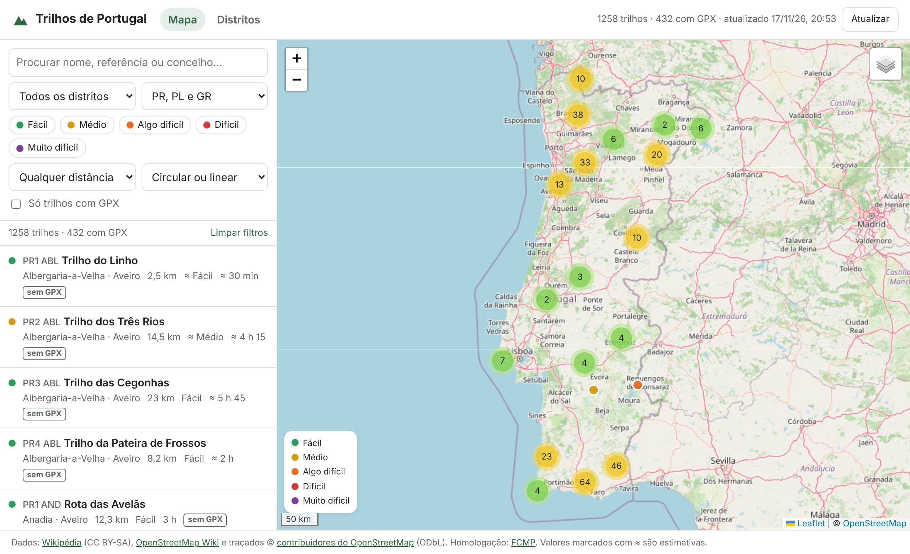

# Trilhos de Portugal

Site para a NAS com **todos os percursos pedestres homologados de Portugal** (Pequenas Rotas, Percursos Locais e
Grandes Rotas): lista com filtros, mapa por distrito e uma página por trilho com distância, dificuldade, duração,
tipo de traçado, entidade promotora, ligação oficial, **mapa do percurso e GPX para descarregar**.



## Como funciona

A app recolhe e junta os dados sozinha, uma vez por semana (e no primeiro arranque):

| Fonte | O que dá |
| --- | --- |
| [Wikipédia — PR](https://pt.wikipedia.org/wiki/Lista_de_percursos_pedestres_de_pequena_rota_em_Portugal) e [GR](https://pt.wikipedia.org/wiki/Lista_de_percursos_pedestres_de_grande_rota_em_Portugal) | Lista de percursos homologados por distrito e concelho, distância, dificuldade, duração, tipo, entidade promotora |
| [Wiki do OpenStreetMap](https://wiki.openstreetmap.org/wiki/Portugal/Percursos_Pedestres) | Percursos (incluindo Açores e Madeira), página oficial e a relação OSM de cada um |
| [OpenStreetMap](https://www.openstreetmap.org) (API + Overpass) | Traçado de cada percurso → mapa e GPX; descobre percursos com referência PR/GR que não estão nas listas |

A FCMP (que homologa os percursos) não publica a lista nem os GPX em formato aberto, por isso estas são as fontes
abertas mais completas. Quando a entidade não indica a dificuldade ou a duração, o site mostra uma **estimativa
(≈)** a partir da distância. Trilhos que ainda não estão desenhados no OpenStreetMap aparecem na lista com
"sem GPX" e ligação para a página oficial.

Dados: Wikipédia (CC BY-SA) e OpenStreetMap (ODbL) — a atribuição aparece no site e nos GPX.

## Instalar na NAS

Guia passo a passo: **[docs/instalacao-nas.md](docs/instalacao-nas.md)** (porta 8092, atualização e backup
automáticos).

## Desenvolvimento

```sh
pip install -r requirements-dev.txt
TRAILS_DB=./data/trails.db uvicorn trails.main:app --reload --port 8092   # http://localhost:8092
pytest -q && ruff check .
```

Recolha manual, sem o site: `TRAILS_DB=./data/trails.db python -m trails.scrape [--catalog-only] [--limit 20]`.

| Ficheiro | |
| --- | --- |
| `trails/sources/` | Leitores de cada fonte (Wikipédia, wiki OSM, OpenStreetMap) |
| `trails/scrape.py` | Junta as fontes, resolve distritos, descarrega traçados |
| `trails/main.py` | API (`/api/trails`, `/api/trails/{id}`, `/api/trails/{id}/gpx`, `/api/districts`, `/api/status`) |
| `trails/static/` | Site (HTML/JS sem build; Leaflet incluído) |
| `deploy/` | Scripts da NAS (atualização, backup, restauro) |

API documentada em `/api/docs`.
